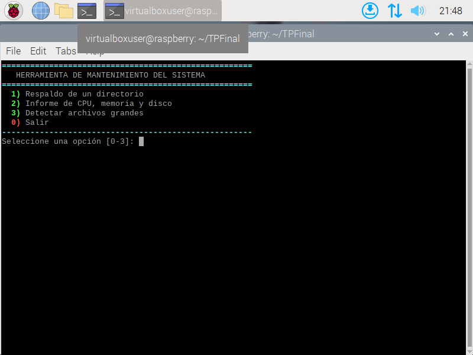
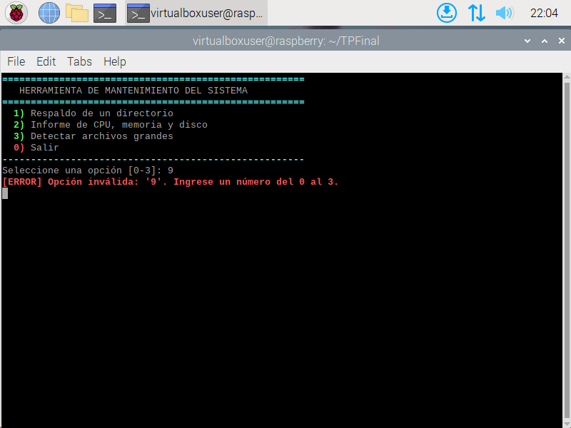
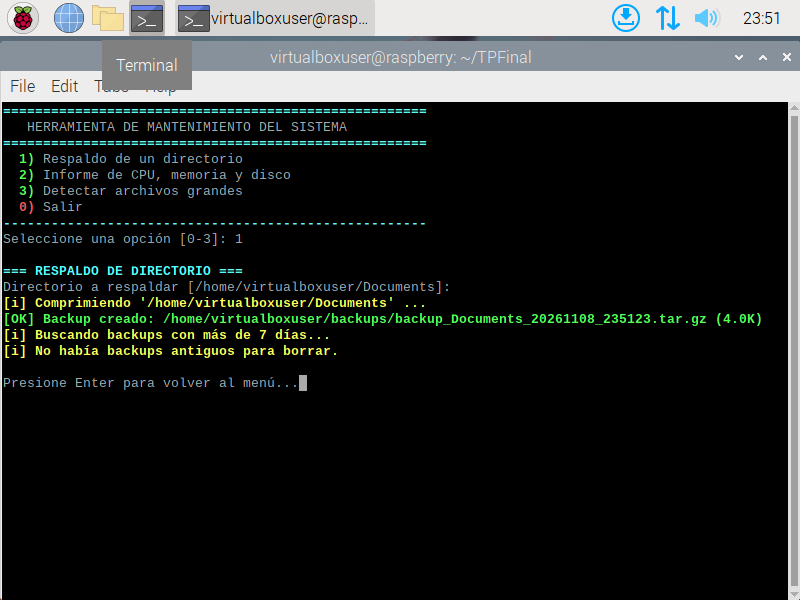
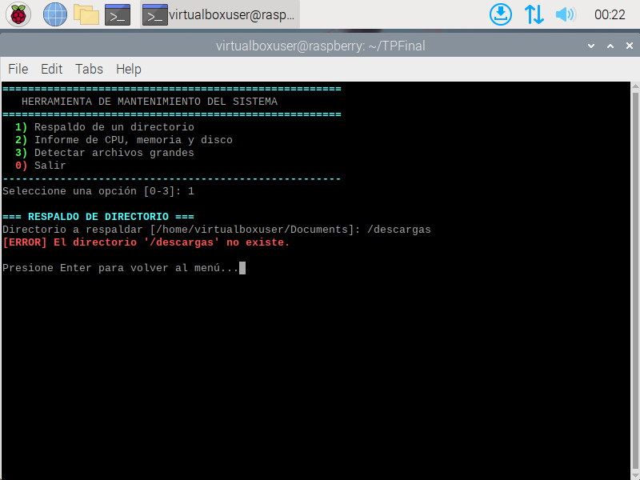
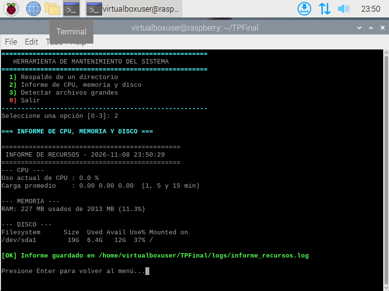
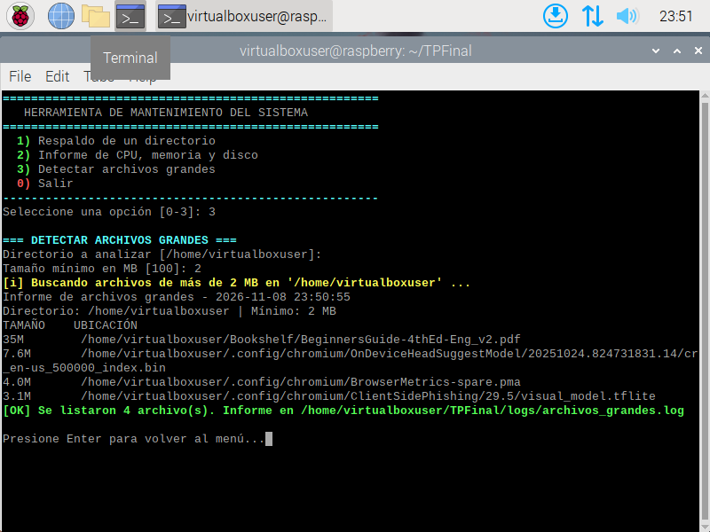
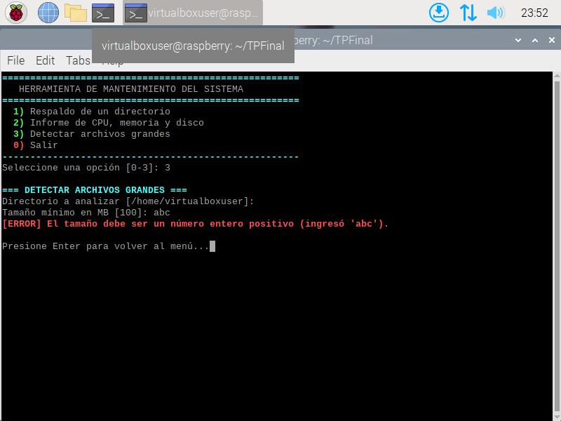
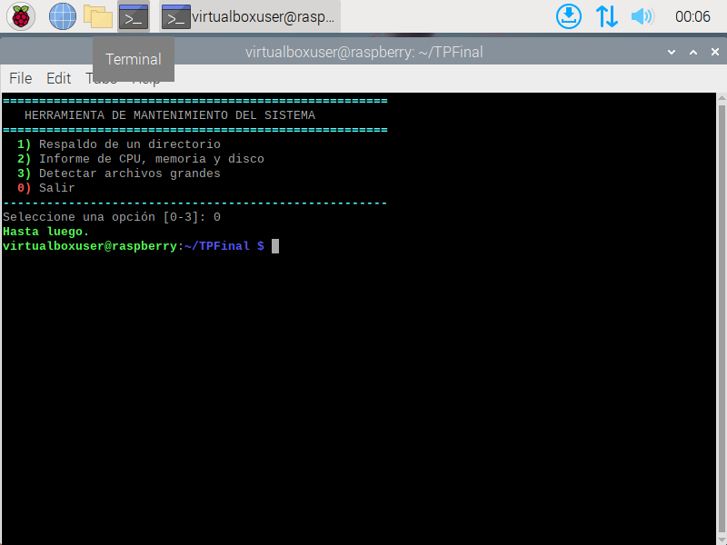

# Memoria Técnica —  Mantenimiento del Sistema Linux en Bash

**Materia:** Sistemas Operativos

**Instituto:** Instituto Superior IDRA — Tecnicatura Superior en Desarrollo de Software

**Integrantes:** Nicolas Olivarez, Rodrigo Curcuy y Jeremias Maglione

**Fecha:** Noviembre de 2026

---

## 1. Introducción

### 1.1 Descripción del proyecto

El proyecto es un script en Bash (`mantenimiento.sh`) que presenta un **menú interactivo** para ejecutar tareas de mantenimiento en un sistema Linux. Evita que el administrador tenga que escribir a mano comandos largos y deja un registro (log) de lo que se hizo.

Se desarrolló y probó en una máquina virtual (VirtualBox) con Raspberry Pi OS, una distribución basada en Debian.

### 1.2 Tareas automatizadas

| Opción | Tarea | Función en el script |
|:------:|-------|----------------------|
| 1 | Respaldo de un directorio en un archivo comprimido y eliminación de backups antiguos | `tarea_backup` |
| 2 | Informe del uso de CPU, memoria y disco guardado en un archivo log | `tarea_informe` |
| 3 | Detección de archivos grandes con informe ordenado por tamaño | `tarea_grandes` |

### 1.3 Extras opcionales implementados

- **Validación de entrada:** el menú solo acepta 0, 1, 2 o 3, y cada dato que se ingresa se verifica.
- **Archivo de configuración** (`config.conf`) para cambiar rutas y parámetros sin editar el código.

---

## 2. Requisitos técnicos

| Requisito | Detalle |
|-----------|---------|
| Sistema operativo | Linux (Raspberry Pi OS en VirtualBox; también funciona en Debian) |
| Intérprete | Bash |
| Herramientas | `tar`, `gzip`, `find`, `sort`, `head`, `awk`, `df`, `du`, `free`, `numfmt`, `tee` |
| Permisos | Usuario común (no requiere `sudo`) |
| Dependencias a instalar | Ninguna: todas vienen con el sistema |

Ejecución:

```bash
git clone https://github.com/nicolasolivarez10-gif/TPFinal.git
cd TPFinal
chmod +x mantenimiento.sh
./mantenimiento.sh
```

---

## 3. Desarrollo (explicación del código)

### 3.1 Estructura del script

1. Colores.
2. Carga de la configuración.
3. Funciones auxiliares (`registrar`, mensajes, `pausar`, validación).
4. Las tres tareas (una función cada una).
5. El menú principal (un bucle `while`).

### 3.2 Colores

```bash
ROJO='\e[1;31m'
VERDE='\e[1;32m'
RESET='\e[0m'
echo -e "${VERDE}[OK] ...${RESET}"
```

Son códigos de escape ANSI: la terminal los interpreta como cambios de color. `echo -e` habilita la interpretación de `\e`. Se usa `RESET` para volver al color normal. Verde indica éxito, rojo error y amarillo información.

## ⚙️ 3.3 Carga de la configuración

El programa primero busca su carpeta principal y carga el archivo `config.conf`, donde se guardan las opciones de configuración.

```bash
DIR_SCRIPT="$(cd "$(dirname "$0")" && pwd)"
source "$DIR_SCRIPT/config.conf"
```

**¿Qué hace cada parte?**

- `DIR_SCRIPT`: guarda la ubicación del script.
- `dirname`: obtiene la carpeta donde está el script.
- `pwd`: obtiene la ruta completa.
- `source`: carga las variables del archivo de configuración.

Si el archivo no existe, se muestra un error y el programa termina con `exit 1`.

> **Objetivo:** Poder cambiar las opciones del programa sin modificar el código principal.

---

## 🧩 3.4 Funciones auxiliares

Son funciones que se utilizan varias veces durante el programa para evitar repetir código.

- **`registrar`:** guarda mensajes con fecha y hora en un archivo log.
- **`mensaje_ok`:** muestra mensajes de éxito y los registra.
- **`mensaje_error`:** muestra errores y los registra.
- **`mensaje_info`:** muestra información en pantalla.
- **`pausar`:** espera que el usuario presione Enter para continuar.
- **`es_numero_positivo`:** comprueba que el valor ingresado sea un número entero mayor que cero.

> **Objetivo:** Mantener el código más organizado y facilitar su lectura.

---

## 📦 3.5 Tarea 1 — Respaldo

Esta función permite crear una copia de seguridad de una carpeta.

### ¿Cómo funciona?

1. El usuario selecciona la carpeta que quiere respaldar.
2. El programa verifica que la carpeta exista.
3. Comprueba que el backup no se guarde dentro de la carpeta original.
4. Crea un nombre para el respaldo utilizando la fecha y hora.
5. Comprime la carpeta en un archivo `.tar.gz`.
6. Si ocurre un error, elimina el archivo incompleto.
7. Borra los backups antiguos según los días configurados.

### Comando principal

```bash
tar -czf "$archivo" -C "$(dirname "$origen")" "$nombre"
```

**Explicación:**

- `tar`: crea el archivo de respaldo.
- `-c`: indica que se va a crear un archivo.
- `-z`: comprime su contenido.
- `-f`: indica el nombre del archivo.
- `-C`: indica desde qué carpeta se realiza el respaldo.

También se utiliza `find` para buscar y eliminar los respaldos antiguos.

> **Resultado:** Se crea una copia de seguridad comprimida y se eliminan los backups viejos que cumplen las condiciones configuradas.

---

## 📊 3.6 Tarea 2 — Informe de CPU, memoria y disco

Esta tarea permite consultar el uso de los recursos de la computadora.

### ¿Qué información muestra?

**CPU:** consulta el archivo `/proc/stat` dos veces, con un segundo de diferencia, para calcular aproximadamente el porcentaje de uso durante ese intervalo.

**Carga promedio:** utiliza `/proc/loadavg` para conocer la carga de trabajo del sistema.

**Memoria RAM:** utiliza el comando `free -m` para mostrar la memoria utilizada y disponible en MB.

**Disco:** utiliza `df -h` para mostrar cuánto espacio está ocupado y cuánto queda disponible.

### Comandos principales

```bash
free -m
df -h
```

- `free -m`: muestra información de la memoria RAM.
- `df -h`: muestra información del almacenamiento.

Para guardar el informe se utiliza `tee -a`, que permite mostrar los resultados en pantalla y guardarlos en un archivo al mismo tiempo.

**Archivo de registro:** `logs/informe_recursos.log`

> **Resultado:** Se puede conocer el estado de los recursos de la computadora y conservar un registro de los resultados.

---

## 🔎 3.7 Tarea 3 — Archivos grandes

Esta función permite encontrar los archivos que ocupan más espacio dentro de una carpeta.

### ¿Cómo funciona?

1. El usuario selecciona la carpeta donde quiere buscar.
2. Ingresa el tamaño mínimo de los archivos en MB.
3. El programa verifica que los datos sean correctos.
4. Busca los archivos que superen el tamaño indicado.
5. Ordena los resultados del más grande al más pequeño.
6. Muestra una cantidad limitada de archivos.
7. Guarda los resultados en un archivo log.

### Comando principal

```bash
find "$dir" -type f -size +"${bytes}"c -printf '%s\t%p\n' 2>/dev/null \
    | sort -rn | head -n "$CANTIDAD_GRANDES"
```

**Explicación:**

- `find`: busca archivos dentro de una carpeta.
- `-type f`: busca solamente archivos.
- `-size`: filtra los archivos según su tamaño.
- `sort -rn`: ordena los resultados de mayor a menor.
- `head -n`: limita la cantidad de resultados.
- `2>/dev/null`: evita mostrar errores de permisos.
- `numfmt`: convierte los tamaños a unidades fáciles de leer, como KB, MB o GB.

**Archivo de registro:** `logs/archivos_grandes.log`

> **Resultado:** Permite identificar archivos que ocupan mucho espacio y facilita el mantenimiento del disco.
### 3.8 Menú interactivo

```bash
while true; do
    mostrar_menu
    read -r -p "Seleccione una opción [0-3]: " opcion
    if [[ ! "$opcion" =~ ^[0-3]$ ]]; then ... continue; fi
    case "$opcion" in
        1) tarea_backup;  pausar ;;
        ...
        0) exit 0 ;;
    esac
done
```

- `while true` repite el menú hasta que el usuario elija salir.
- La **validación** usa una expresión regular: solo acepta un único dígito entre 0 y 3. Si no, muestra un error en rojo y vuelve a mostrar el menú (`continue`).
- `case` llama a la función de la tarea elegida.
- La opción `0` ejecuta `exit 0` y detiene el script.
- 

---

## 4. Pruebas y validación

### Validación del menú

Ingresar `x`, `9` y una entrada vacía. Resultado esperado:

```
[ERROR] Opción inválida: 'x'. Ingrese un número del 0 al 3.
```


### Opción 1 — Respaldo

Directorio: `~/prueba/datos`. Resultado obtenido:



Con un directorio inexistente se muestra `[ERROR] El directorio '...' no existe.`




### Opción 2 — Informe de recursos

Se verifica que el informe quedó guardado: `cat logs/informe_recursos.log`. 



### Opción 3 — Archivos grandes



Con mínimo `abc` se muestra `[ERROR] El tamaño debe ser un número entero positivo`. Con un mínimo mayor al archivo más grande, informa que no se encontraron archivos.



### Opción 0 — Salir

Muestra "Hasta luego." y termina el script. El log `logs/mantenimiento.log` queda con el registro de todo lo realizado:



---

## 5. Reflexiones finales

### Conclusión

El trabajo permitió aplicar en un caso concreto conceptos de la cursada: comandos de archivos y procesos, redirecciones y tuberías, compresión con `tar`, búsqueda con `find`, lectura de `/proc` y scripting en Bash. Un script modular, con funciones y archivo de configuración, es fácil de entender y de ampliar.

---

## 6. Referencias

- `man bash`, `man find`, `man tar`, `man df`, `man free`
- Apuntes de la cátedra: *Linux Bash Shell Cheat Sheet* y *Markdown Cheat Sheet* (opensource.com)

---

## 7. Dificultades encontradas
.Instalacion de virtualbox por mal configuramiento

.Problemas en los script por error en el codigo

